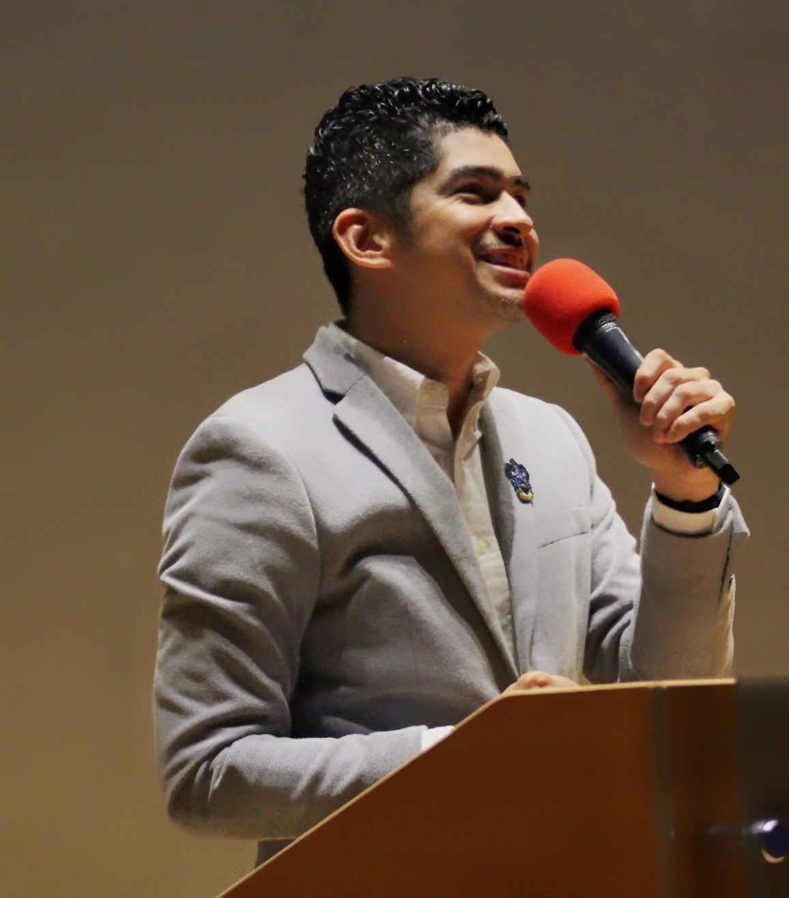
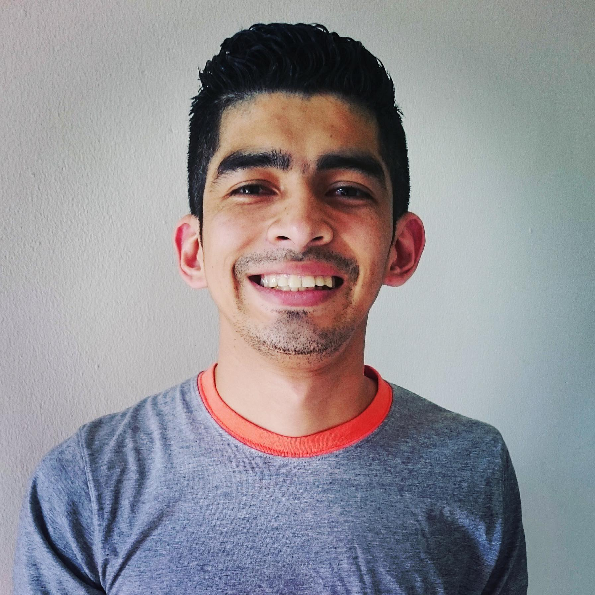
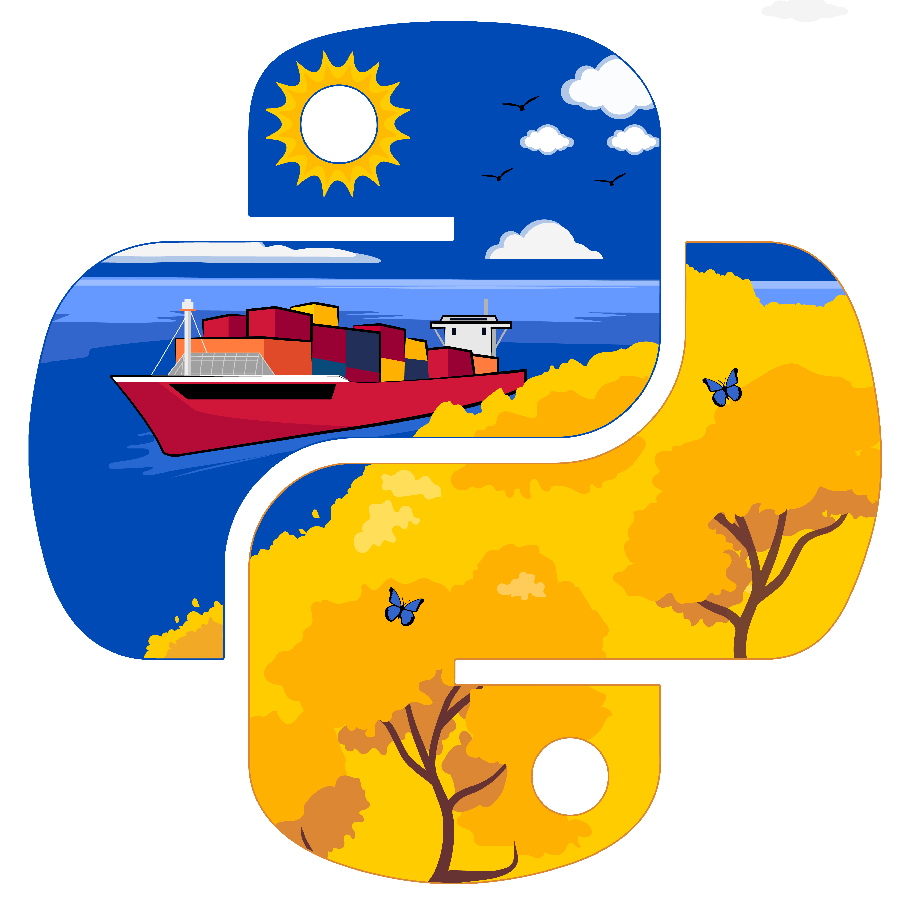

# Arnulfo Reyes

*Inspiro, conecto y guío a las personas para transformar el futuro juntos.*

[Python Panamá](https://pythonpanama.org/) · [PyCon Panamá](https://pycon.pa/) · [Fedora Project](https://fedoraproject.org/wiki/User:Josereyesjdi) · [GitHub](https://github.com/yosef7)

---

**Contenido:** [Versión corta](#versión-corta) · [Versión extensa](#versión-extensa) · [Fotos oficiales](#fotos-oficiales)

---

## Versión corta

Arnulfo Reyes inspira, conecta y guía a las personas para que aprendan, compartan lo que saben y crezcan juntas. El rol que más disfruta es el de voluntario: ayudar a otras personas y apoyar a las comunidades tecnológicas, con la disposición de colaborar con iniciativas de cualquier país de Latinoamérica.

Desde [Python Panamá](https://pythonpanama.org/) impulsa [PyCon Panamá](https://pycon.pa/), [Python Route](https://pythonpanama.org/python-route), [PyCafé](https://pythonpanama.org/blog/python-panama-2024), talleres y espacios de colaboración que acercan la programación, los datos y la inteligencia artificial a estudiantes y profesionales. Su labor busca conectar personas, conocimiento y oportunidades para fortalecer el ecosistema tecnológico de Panamá.

Su participación comunitaria también tiene alcance internacional: ha sido ponente en [Python Brasil](https://www.youtube.com/watch?v=O3r8LN2ITdA) (Brasil), [PyDay Chile](https://pyday.cl/2022/) (Chile) y FUDCon LATAM (Perú), y como parte del [Proyecto Fedora](https://fedoraproject.org/wiki/User:Josereyesjdi) ha participado en Flock (Alemania) y DevConf.US (Estados Unidos).

En lo profesional, pone al servicio de ese propósito su experiencia en auditoría, tecnología, analítica de datos, automatización y gestión de proyectos, actualmente en [Copa Airlines](https://www.copaair.com/). Posee una maestría en Dirección de Proyectos y Liderazgo Empresarial por [Quality Leadership University (QLU)](https://qlu.ac.pa/).

**“Inspiro, conecto y guío a las personas para transformar el futuro juntos.”**

## Versión extensa

Arnulfo Reyes es profesional de auditoría, tecnología y análisis de datos en [Copa Airlines](https://www.copaair.com/), además de coordinador de [Python Panamá](https://pythonpanama.org/). Cuenta con más de 10 años de experiencia profesional, durante los cuales ha trabajado en áreas relacionadas con tecnología, análisis de información, automatización de procesos, estadística, auditoría, gestión de proyectos y mejora continua.

Su trayectoria profesional ha evolucionado desde funciones técnicas de soporte y análisis hasta posiciones vinculadas con analítica, auditoría y coordinación, lo que le ha permitido desarrollar una visión integral de cómo la tecnología, los datos y los procesos pueden utilizarse para mejorar la toma de decisiones dentro de las organizaciones.

Posee una maestría en Dirección de Proyectos y Liderazgo Empresarial por [Quality Leadership University (QLU)](https://qlu.ac.pa/), formación que complementa su experiencia en gestión, planificación, liderazgo y coordinación de equipos multidisciplinarios.

En su trabajo utiliza tecnologías como Python y SQL para analizar información, automatizar procesos y desarrollar soluciones basadas en datos. También trabaja con herramientas de análisis, visualización, procesamiento de datos y control de versiones dentro de entornos empresariales.

Paralelamente a su carrera profesional, participa activamente en la comunidad tecnológica de Panamá. Forma parte de [Python Panamá](https://pythonpanama.org/) desde 2014 y desde 2019 participa en su coordinación y liderazgo, impulsando iniciativas orientadas a hacer el conocimiento tecnológico más accesible y a crear oportunidades de aprendizaje para nuevas generaciones.

Desde la comunidad ha participado en la organización de meetups, talleres, conferencias y programas educativos como [PyCon Panamá](https://pycon.pa/), [Python Route](https://pythonpanama.org/python-route) y [PyCafé](https://pythonpanama.org/blog/python-panama-2024), además de actividades realizadas en colaboración con universidades, empresas y organizaciones de tecnología.

Su participación internacional incluye su presentación en **Python Brasil 2021**, con la charla [«Transforma tu vida personal y profesional con Python»](https://www.youtube.com/watch?v=O3r8LN2ITdA), disponible en el canal de YouTube de Python Brasil. También participó como ponente en [PyDay Chile 2022](https://pyday.cl/2022/), con una charla sobre la importancia de participar en comunidades de programación.

Su [trayectoria documentada en Fedora](https://fedoraproject.org/wiki/User:Josereyesjdi) registra su labor como embajador desde 2015, su participación como ponente en FUDCon LATAM 2016 en Puno, Perú, y su participación en el Fedora Activity Day de Cusco en 2017. También registra su asistencia a Flock 2018 en Dresde, Alemania, y su participación en DevConf.US 2022 en Boston, Estados Unidos. Estas actividades forman parte de su vinculación con las comunidades internacionales de software libre y código abierto.

El voluntariado es el rol que más disfruta en su vida comunitaria. Le motiva ayudar a otras personas, compartir lo que sabe y apoyar a quienes organizan espacios de aprendizaje. Esa vocación de servicio trasciende las fronteras de Panamá: está dispuesto a colaborar con comunidades e iniciativas de cualquier país de Latinoamérica.

Su visión de liderazgo parte de una idea sencilla: el conocimiento adquiere mayor valor cuando se comparte.

---

## Fotos oficiales

Fotografías e imágenes autorizadas para acompañar esta biografía en programas de eventos, carteles, redes sociales y notas de prensa. Haz clic en una imagen para abrirla en tamaño completo.

<table>
  <tr>
    <td align="center" width="25%">
       
      <b>Ponente</b> 
      Recomendada para eventos
    </td>
    <td align="center" width="25%">
       
      <b>Retrato · azul</b> 
      Formato vertical
    </td>
    <td align="center" width="25%">
       
      <b>Retrato · gris</b> 
      Formato cuadrado (avatar)
    </td>
    <td align="center" width="25%">
       
      <b>Logo Python Panamá</b> 
      Ilustración comunitaria
    </td>
  </tr>
</table>

### Archivos originales

| Imagen | Resolución | Tamaño | Ruta en el repositorio | Descarga |
| --- | :---: | :---: | --- | :---: |
| Ponente | 1156 × 1314 px | 220 KB | [`bio/jr-white.jpg`](jr-white.jpg) | [Original](https://raw.githubusercontent.com/yosef7/yosef7/master/bio/jr-white.jpg) |
| Retrato · azul | 1737 × 2171 px | 710 KB | [`bio/jr_blue.jpg`](jr_blue.jpg) | [Original](https://raw.githubusercontent.com/yosef7/yosef7/master/bio/jr_blue.jpg) |
| Retrato · gris | 1792 × 1792 px | 338 KB | [`bio/jr_grey.jpg`](jr_grey.jpg) | [Original](https://raw.githubusercontent.com/yosef7/yosef7/master/bio/jr_grey.jpg) |
| Logo Python Panamá | 4500 × 4500 px | 1,8 MB | [`bio/python_logo.jpg`](python_logo.jpg) | [Original](https://raw.githubusercontent.com/yosef7/yosef7/master/bio/python_logo.jpg) |

> [!TIP]
> El enlace **Original** abre el archivo en resolución completa; usa *clic derecho → Guardar enlace como…* para descargarlo. También puedes clonar el repositorio completo con `git clone https://github.com/yosef7/yosef7.git` y encontrar las imágenes en la carpeta `bio/`.
